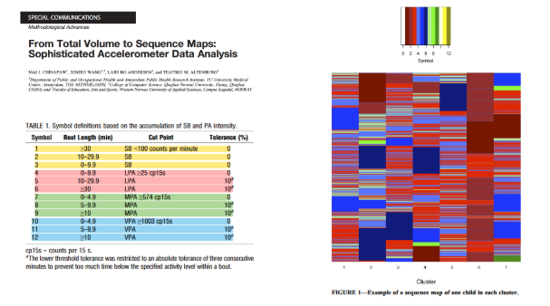
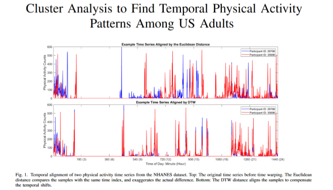

# Internship project 
My internship project is part of the APPROCHE(-S) study (CHU Nîmes, department of physical medicine and rehabilitation). The objective of this sudy is to describe predictive factors for the success of rehabilitation programs in chronic low back pain. The study is based on activity limitation and associated factors that can predict the success of rehabilitation programs (psychological, physical, social factors). Evaluation is based on questionnaires, 3D movement evaluation (gait, balance, trunk positioning, trunk flexion, lifting), and accelerometer data.

The project is divided into two parts (described below) :
    - 1 : Precise description of motor comportment  
    - 2 : Validation of walking data 

#### Task list for the Master 2 internship work
1. Reproducible pipeline for reading and preprocessing .gt3x files related to the gait branch.
2. Walking detector documenté, avec gestion explicite des pauses courtes, virages et bouts élémentaires.
3. Stride/cycle detector documenté et validé contre Qualisys.
4. Rapport de validation WALK/non-WALK sur parcours semi-écologique.
5. Rapport de validation cadence, mean stride time et variabilité temporelle.
6. Décision argumentée concernant stride length et walking speed.
7. Implémentation du noyau d'organisation linéaire : ACF regularity, spectral power/width, IH selon
faisabilité.
8. Implémentation et convergence des métriques non linéaires retenues, avec focus HKp 50-150 foulées.
9. Analyses de robustesse à l'orientation et à la vitesse.
10. Analyse de l'effet des erreurs de timing sur les métriques avancées.
11. Système de QC par sujet/jour/bout/métrique.
12. Documentation complète : versions logicielles, paramètres, pseudo-code/diagramme du pipeline et
décisions méthodologiques

## 1 Description of motor comportment
From raw accelerometer data over 7 days to a multi-scale characterization of motor behavior and walking in real-life settings.

### Reference framework 
**LBP and physical activity** : Physical activity is a key factor in management of CLBP. A prospective study on a 71 600 subjects cohort (UK biobank) showed that moderate physical activity and a 60 min/day duration was associated with a lower risk of developing CLBP (1). But, there is a lack of knowledge regarding the distribution of physical activity in patients with CLBP, and the way in which it is accumulated or fragmented.

**Problematic** :  What can be described in a defensible way from 7 days of raw accelerometry at the hip?

**Objective** : Describe the way in which activity is accumulated or fragmented, temporal organization during the day and week, and eventually the complexity/variability of activity sequences.

**2 ways** : 

Whole week movement behavior : 
        Question : How does the person organize his/her whole motor behavior over the week?
        Analysis level : Sujet / jour / séquences d’états
        Ouput : volume, intensity, accumulation, fragmentation, temporality, repertoire/complexity, data-driven states

free living gait. 
        Question : when does the person walk, how much, in which contexts, and how is his/her gait organized?
        Analysis level : Sujet / jour / walking bout / foulée   
        Outuputs : Walking bouts, cadence, stride timing, macro-gait, regularity/spectral, SampEn, RQA, HKp, LDS/ACI, DFA conditionnel.

### Data description 
Accelerometer WGT3-X BT : acceleration + gravitational composante + noise.
Position : right hip, vertical axis aligned with gravity, horizontal axis aligned with the sagittal plane. ?
Sampling frequency : 100 Hz ?
Duration : 7 days.
Epochs = 5 / 30 / 60 sec ? (test)

### Analysis of accelerometer data
#### Extract raw acceleration data from ActiGraph files
The actigraph files are in .gt3x format, which is a proprietary binary format used by ActiGraph devices to store raw accelerometer data. To extract the raw acceleration data from these files,two strategies can be considered: using the ActiGraph software (ActiLife) to export the data in a readable format (e.g., CSV), or using open-source libraries such as **actipy**, **pygt3x** in Python or **GGIR** in R to directly read and process the .gt3x files. 

actipy and pygt3x don't work on my computer : pygt3x necessitates puthon 3.10 and crashes on my computer. actipy necessitates python 3.11 but took more than 28 min to read a 7 days files. CGIR seems to have the same problem. 

I should probably use the ActiGraph software to export the data in CSV format, which can then be processed using Python or R for further analysis.

#### Preprocessing 

The processing of raw accelerometer data will follow several main steps. 

First, the raw triaxial acceleration signals (X, Y and Z) will be extracted from the ActiGraph files and checked for data quality and non-wear periods. The signals will then be calibrated to correct for potential measurement biases and, if required, filtered (not ENMO and MAD (6) and resampled according to the selected processing pipeline. 

Two open-source approaches can be considered for the pre-processing of the raw accelerometer data: **actipy**, a Python-based toolbox that provides gravity-based calibration and signal processing, and **GGIR**(7), an R package widely used for processing raw accelerometer data and implementing automatic calibration.

#### Wearable-specific indicators of PA behavior (WIPAB)** ?
Counts are the most commonly used metric. It is derived from the raw acceleration signal using a proprietary algorithm. However, this method has limitations related to its dependence on the ActiGraph algorithm. Raw data potentially allow extracting richer and more comparable metrics. 

According to Backes et al. (4), physical activity behavior can be characterized through three complementary dimensions: activity intensity distribution, activity accumulation over time, and temporal organization, including the correlation and regularity of activity patterns. these dimensions are complementary and provide a comprehensive understanding of an individual's physical activity behavior. 

Exemple : 
| Participant | Typical activity pattern | Activity intensity distribution | Activity accumulation | Temporal correlation |
|---|---|---|---|---|
| **Older active adult** | Very active throughout the day, with many low-intensity movements and short trips | **More concentrated at low intensities** — potentially a more negative IG | **Highly fragmented** — many short bouts and relatively few long bouts | **Potentially stronger short-term correlations** if similar activity levels tend to follow one another |
| **30-year-old office worker** | Mostly sedentary during working hours, followed by ~2 h of vigorous exercise | **More spread toward higher intensities** — potentially a less negative IG | **More concentrated** — long sedentary periods and potentially long exercise bouts | **Strong temporal structure at specific time scales** — prolonged sedentary work periods followed by exercise |
| **Delivery worker** | Frequent transitions, walking, carrying parcels and short periods of faster movement | **Broad distribution of intensities** — activity spread across low-to-high intensities | **Fragmented but active** — many relatively short activity bouts and frequent transitions | **Potentially weaker/complex short-term regularity** because activity fluctuates frequently throughout the day |

##### Bouts
Cotinous periods of activity or inactivity, defined based on a threshold of movement intensity (e.g., ENMO). Bouts can be characterized by their duration, frequency, and distribution throughout the day.Bouts necessitate to compute the ENMO values first, and then to define a threshold to classify activity into bouts. For example, a bout of moderate-to-vigorous physical activity (MVPA) can be defined as a continuous period of at least 10 minutes with ENMO values above a certain threshold (e.g., 100 mg). The duration and frequency of bouts can provide insight into the accumulation and fragmentation of physical activity throughout the day.

##### A.Activity accumulation

**ENMO : Euclidean Norm Minus One (6)** 
A measure of acceleration intensity derived from raw triaxial accelerometer data. It is calculated by taking the square root of the sum of the squares of the three axes, subtracting 1g (the gravitational component), and setting negative values to zero. ENMO provides a continuous measure of movement intensity, allowing for the assessment of physical activity levels throughout the day. 

$$
ENMO = \max(\sqrt{x^2 + y^2 + z^2} - 1g, 0)
$$

    
Results are expressed in milligravity (mg) units, where 1 mg = 0.001 g.

For the main analysis, the ENMO calculation will be implemented directly in **Python** in order to maintain control and transparency over each step of the computation. An epoch can be defined to aggregate the ENMO values over a specific time window (e.g., 1 second, 1 minute) to facilitate further analysis and interpretation of physical activity patterns.It is calculated as the average of the ENMO values within the epoch. 
The ENMO values can be used to classify physical activity into different intensity levels (e.g., sedentary, light, moderate, vigorous) based on established cut-points or thresholds.

**MAD : Mean Absolute Deviation (6)**, 
A measure of the average absolute difference between each data point and the mean. It is used to assess the variability of the acceleration signal. It is calculated by taking the absolute difference between each data point and the mean, summing these differences, and dividing by the total number of data points. MAD provides insight into the variability of movement intensity over time.

$$
MAD = \frac{1}{n} \sum_{i=1}^{n} \left|x_i - \bar{x}\right|
$$

Mad also needs a time periode to be specified. A 5-second time period can be considered adequate for reporting different activities (6). 

**thresholds** : Several ENMO thresholds have been proposed to classify physical activity intensity. For example, Hildebrand et al. (2016) identified thresholds for sedentary, light, moderate, and vigorous activity using raw acceleration data collected with an ActiGraph accelerometer worn at the hip in adults (9). Thresholds are useful to define bouts of activity or inactivity. 

##### B.Temporal correlation and regularity

**Sequence maps**: 
The objective of this par is to determine how many different states are used and how do they follow each other. 

This can be done by creating a sequence map (10), which is a visual representation of the transitions between different states over time.  Chinapaw et al (10) used accelereometrics counts to measure intensity (SB, LPA, MPA, and VPA) and duration (sporadic accumulation or in bouts of different duration) to code the activity into a sequence of states. The sequence map can then be analyzed with **Hierarchical cluster analysis** clusters with similar behavioral sequence maps. 

The method is available on github (11)

Exemple (from Chinapaw et al, 2019) :

The problem is that the clustering approach may group together sequences that are similar in terms of the states used, but not necessarily in terms of the order in which they occur. This could lead to a loss of temporal information and succession of states.  The use of hierarchical clustering (hclust in R) does not, in itself, guarantee that temporal order is preserved. 

The distance matrix is a key component in the clustering process, as it quantifies the dissimilarity between different sequences. Diffferents methods are possible : **Hamming, Optimal matching, Dynamic time warping**. 

**Hamming distance** measures the number of positions at which two sequences differ. It is a simple and efficient method for comparing sequences of equal length (AABA vs ABAA = 2). However, it does not telarate temporal shifts wich make it to strict for daily activity sequences.

**Optimal Matching** (OM) is a more flexible method that allows for insertions, deletions, and substitutions to align sequences of different lengths. It calculates the minimum cost of transforming one sequence into another, taking into account the order of states. This method is more suitable for comparing sequences with varying lengths and temporal shifts.

The main problem of this method will be to determine the cost of each operation (insertion, deletion, substitution). The cost can be set to 1 for each operation, but this may not accurately reflect the true dissimilarity between sequences. For example, the substitution between two similar states (1/2/3 ; 4/5/6 ; 7/8/9) can be considered less costly than the substitution between two very different states (1/6). But we will have to determine if the suppression of intensive states is more costly than the suppression of sedentary states. This method also seems to be to strict to compare daily activity sequences.

As our objective is to compare and analyze daily activity sequences while allowing for some temporal shifts, we will probably use DTW. 

**Dynamic Time Warping (DTW)**

DTW is a method that aligns two sequences in a way that minimizes the total distance between them, allowing for non-linear alignments. It is particularly useful for comparing time series data where the timing of events is important but not perfectly synchronized. It can be associate with the Sakoe–Chiba band that limits the warping path to a certain window (30 min) and prevent excessive warping.

Exemple from Guo et al. 2023

Occupancy, entropies, Lempel-Ziv, états HSMM, transitions. Quand l’activité survient-elle et à quel point le profil est-il stable d’un jour à l’autre ?Profils horaires, variabilité interjour, weekday/weekend, similarité de profils.

##### C. Activity intensity distribution
**Intensity gradient (8):**
A measure that describes the distribution of physical activity intensity across different levels, providing insight into how much time is spent at various intensities. It necessarily requires a continuous measure of intensity such as ENMO. The intensity of each epoch is calculated, and the time spent at each intensity level is determined. The intensity gradient is then derived by plotting the cumulative time spent at each intensity level against the corresponding intensity values. 
    
The gradient (slope) of this regression describes the distribution of activity intensity: a more negative gradient indicates that time is more strongly concentrated at lower intensities, whereas a less negative gradient indicates a more even distribution of time across the intensity spectrum. 

Rather than classifying physical activity using predefined intensity cut-points, the Intensity Gradient describes the continuous relationship between activity intensity and the time accumulated at each intensity.

## 2 Validation of walking data
A more practical and methodological section dedicated to walking, a potential basis for a future, more detailed data analysis. We have an ActiGraph worn on the hip for 7 days, but it is necessary to validate precisely what we are able to extract from it regarding walking episodes and certain characteristics of this activity.
Pilot phase followed by an independent validation, using the Qualisys laboratory and force platforms as references, as well as a small semi-ecological course filmed (BORIS).

## References 
1. Zhu Y, Liu D, Yin X, Wang J, Zhang TJ, Wu N. Accelerometer-measured intensity-specific physical activity, genetic susceptibility, and back pain risk: a UK Biobank cohort study. Spine J. juin 2026;26(6):1070‑82. doi:10.1016/j.spinee.2025.10.021 PubMed PMID: 41106605.

2. Neishabouri A, Nguyen J, Samuelsson J, Guthrie T, Biggs M, Wyatt J, et al. Quantification of acceleration as activity counts in ActiGraph wearable. Sci Rep. 13 juill 2022;12(1):11958. doi:10.1038/s41598-022-16003-x PubMed PMID: 35831446; PubMed Central PMCID: PMC9279376.

3. Sadeghi Janbahan K, Espin-Garcia O. Methods for classifying physical activities using accelerometer data: a scoping review. NPJ Digit Med. 6 mai 2026;9(1):534. doi:10.1038/s41746-026-02694-3 PubMed PMID: 42091626; PubMed Central PMCID: PMC13357583.

4. Backes A, Gupta T, Schmitz S, Fagherazzi G, van Hees V, Malisoux L. Advanced analytical methods to assess physical activity behavior using accelerometer time series: A scoping review. Scand J Med Sci Sports. janv 2022;32(1):18‑44. doi:10.1111/sms.14085 PubMed PMID: 34695249; PubMed Central PMCID: PMC9298329.

5. van Hees VT, Gorzelniak L, Dean León EC, Eder M, Pias M, Taherian S, et al. Separating movement and gravity components in an acceleration signal and implications for the assessment of human daily physical activity. PLoS One. 2013;8(4):e61691. doi:10.1371/journal.pone.0061691 PubMed PMID: 23626718; PubMed Central PMCID: PMC3634007.

6. Bakrania K, Yates T, Rowlands AV, Esliger DW, Bunnewell S, Sanders J, et al. Intensity Thresholds on Raw Acceleration Data: Euclidean Norm Minus One (ENMO) and Mean Amplitude Deviation (MAD) Approaches. PLoS One. 2016;11(10):e0164045. doi:10.1371/journal.pone.0164045 PubMed PMID: 27706241; PubMed Central PMCID: PMC5051724.

7. van Hees VT, Fang Z, Langford J, Assah F, Mohammad A, da Silva ICM, et al. Autocalibration of accelerometer data for free-living physical activity assessment using local gravity and temperature: an evaluation on four continents. J Appl Physiol (1985). 1 oct 2014;117(7):738‑44. doi:10.1152/japplphysiol.00421.2014 PubMed PMID: 25103964; PubMed Central PMCID: PMC4187052.

8. Rowlands AV, Edwardson CL, Davies MJ, Khunti K, Harrington DM, Yates T. Beyond Cut Points: Accelerometer Metrics that Capture the Physical Activity Profile. Medicine & Science in Sports & Exercise. juin 2018;50(6):1323‑32. doi:10.1249/MSS.0000000000001561

9. https://www.maths.bris.ac.uk/R/web/packages/GGIR/vignettes/CutPoints.html?utm_source 

10. Chinapaw MJ, Wang X, Andersen LB, Altenburg TM. From Total Volume to Sequence Maps: Sophisticated Accelerometer Data Analysis. Med Sci Sports Exerc. avr 2019;51(4):814‑20. doi:10.1249/MSS.0000000000001849 PubMed PMID: 30882752.

11. https://github.com/wadpac/movement-sequence-mapping/blob/master/main_script.R 

12. Analysis of Variance based on the Hamming Distance BY HILDETE PRISCO PINHEIRO

13. Guo J, Gelfand SB, Hennessy E, Aqeel MM, Eicher-Miller HA, Richards EA, et al. Cluster Analysis to Find Temporal Physical Activity Patterns Among US Adults. 2023. doi:10.1101/2023.01.23.23284777 PubMed PMID: 36747782; PubMed Central PMCID: PMC9901066.
